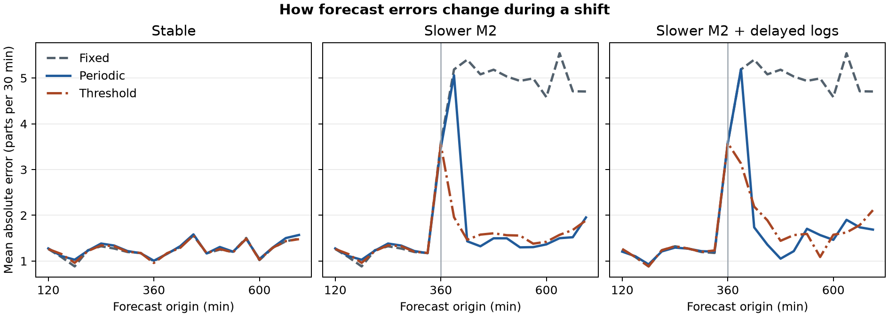

# Event-Driven Calibration of a Manufacturing Line Simulator

How should a production forecast update when a machine slows down? This Python lab
compares a fixed forecast, a scheduled recalibration, and a threshold-triggered
recalibration on the same virtual shifts. It reports how accurately each policy
forecasts the next 30 minutes of output and how frequently it changes the model.

## Full experiment results

With a 15-minute operation-log delay, the threshold policy updated **2.96 times
per shift**, compared with **10.00** for the periodic policy. Their paired
post-change MAE difference (threshold minus periodic) was **−0.051 parts per
30 minutes**, with a 95% confidence interval of **−0.227 to +0.124**. The interval
contains zero. The threshold policy took 96.25 minutes on average to recover its
estimate under delay, compared with 77.50 minutes for the periodic policy.



[Read the technical report (PDF)](docs/technical-report.pdf) ·
[Read the report in Markdown](docs/technical-report.md) ·
[See the second figure](docs/figures/calibration-tradeoff.png) ·
[Inspect the full-run summary](docs/evidence/summary.json) ·
[Inspect per-shift metrics](docs/evidence/run-metrics.csv)

## Run locally

Install [uv](https://docs.astral.sh/uv/getting-started/installation/) and run these
commands from the repository root. uv can provision Python 3.12 and installs the
dependencies from the committed lockfile.

```sh
uv sync --locked
uv run --locked pytest -q
uv run --locked python -m line_calibration demo
uv run --locked python -m line_calibration study --profile quick --out results/quick
uv run --locked python -m line_calibration study --profile full --out results/full
```

The deterministic demo uses a one-slot buffer and two stations taking one and two
minutes per part. The first three parts leave at **3, 5, and 7 minutes**. At minute 4,
M1 finishes part 4 and holds it until M2 takes part 3 from the buffer at minute 5.
The separate stochastic check uses the same topology with two independent
exponential service times of mean one minute. It compares the simulated throughput
to the analytic value of **45 parts per hour**.

The quick profile runs two shifts per scenario and four simulation rollouts per
forecast. The full profile uses 24 independent shifts per scenario and 16 rollouts.
Use the full profile for reported results. The commands require no external data.

## Experiment

```text
Unlimited input -> M1 -> [3 waiting slots] -> M2 -> [3 waiting slots] -> M3 -> Output
```

- The virtual line starts from nominal means of 0.95, 1.00 and 1.10 minutes per
  operation. In the drift scenarios, M2 operations starting at or after minute 360
  have a mean of 1.40 minutes. The time already sampled for an operation in progress
  stays attached to that operation.
- Every 30 minutes after the warm-up, each policy sees the same observable machine
  and buffer state. The delay scenario holds operation records for 15 minutes.
  Machine state snapshots are assumed to be available at the forecast origin.
- The forecast uses a Gamma service model to predict the output of a synthetic line
  with lognormal service times. Only the M2 mean can change. The fixed model keeps
  the initial estimate. The periodic model checks on the hour. The threshold model
  checks at each forecast origin for a relative shift of at least 15%. An update
  needs a full window of 20 M2 records, including at least 10 new ones since the last
  update.
- Each forecast uses only records available strictly before its origin. Performance
  is scored against the number of departures in the next half-open 30-minute
  window. Paired confidence intervals use one mean-error difference per independent
  shift.

## Outputs

| File | Contents |
| --- | --- |
| `forecasts.csv` | Forecasts, realised counts, model estimates and updates by origin |
| `run-metrics.csv` | Post-change MAE, update counts and recovery time by run and policy |
| `example-operation-log.csv` | One delayed virtual shift with processing and availability timestamps |
| `summary.json` | Fixed protocol, seeds, primary contrast and descriptive metrics |
| `forecast-error.png` | Forecast error over time in each scenario |
| `calibration-tradeoff.png` | M2 estimate and the forecast-error/update-frequency trade-off |

Start with `src/line_calibration/line.py` to follow the SimPy processes. Then read
`calibration.py` for the update rules, `forecast.py` for snapshot-based forecasting,
and `study.py` for the replay and scoring protocol.
