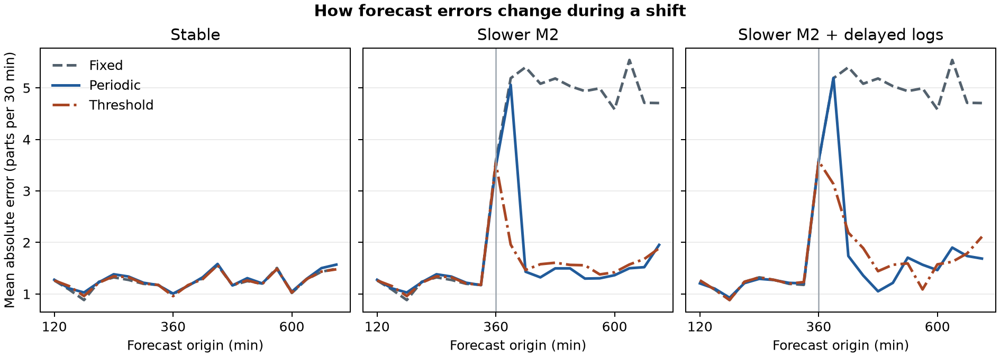
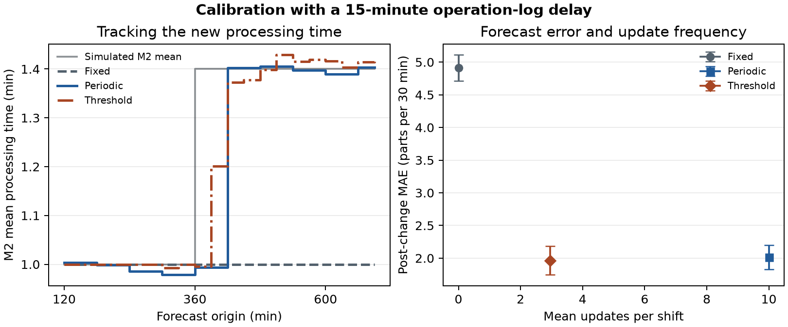

# Event-driven calibration of a production-line simulator

Technical report | Reproducible synthetic study | 19 November 2026

## 1. Purpose and model

**A threshold rule reduced calibration updates substantially while forecast accuracy remained statistically uncertain relative to hourly recalibration with operation logs arriving 15 minutes late.** Across 24 independent virtual shifts, its paired difference in mean absolute error was -0.051 parts per 30-minute forecast, with a 95% confidence interval of [-0.227, 0.124]. It used 2.96 updates per shift versus 10.00 for the periodic rule. The result applies to this controlled synthetic prototype.

The study examines whether a simulator can keep its short-term output forecasts useful after a machine becomes slower while changing its parameters only when new evidence warrants an update. Fixed, periodic and threshold calibration rules are compared on the same realized production histories. Calibration changes the forecasting model while the simulated production line follows its prescribed trajectory.

Online digital-twin research distinguishes estimating the current system state from updating model parameters. Hu and Yan demonstrate a particle-filter approach to calibration with multiple parameters [1]. This project studies a narrower, transparent case with directly available state and estimation of the middle station's mean processing time. Its calibration method uses a rolling mean and a threshold rule. [Hu and Yan, 2024](https://informs-sim.org/wsc24papers/inv175.pdf).

### Line mechanics and assumptions

The SimPy model has three serial, single-machine stations, M1, M2 and M3. Supply before M1 and the sink after M3 are unrestricted. Two intermediate FIFO buffers each hold three waiting jobs, excluding the jobs occupying the machines. The modeled scope consists of processing, queueing, blocking and transfer, with continuous machine availability and a single product type.

Service completion and downstream transfer are separate events. A machine that finishes processing while the next buffer is full retains its completed job and blocks until room becomes available. Its processing-time record ends at service completion, keeping downstream blocking time separate from measured processing duration. This distinction is essential when calibrating a bottleneck from event records.

| Quantity | Prototype setting |
| --- | --- |
| Nominal service means, M1 / M2 / M3 | 0.95 / 1.00 / 1.10 minutes |
| Truth service distribution | Lognormal; coefficient of variation 0.30 |
| Forecast service distribution | Gamma; coefficient of variation 0.30 |
| Shift and observation period | 720 minutes; first forecast at minute 120 |
| Drift intervention | M2 mean becomes 1.40 minutes at minute 360 |

The slower mean applies only to M2 operations that start at or after minute 360. An operation already processing retains its original draw. The truth and forecasting simulations use separate random streams and different distribution families. The latter introduces modest distributional mismatch while retaining the same mean and variability. Both share the same line mechanics. Independent validation of those mechanics remains a separate requirement.

<!-- pagebreak -->

## 2. Observations, calibration and forecasting

### A causal update cycle

At each forecast origin t = 120, 150, ..., 690 minutes, the truth simulator advances to immediately before events at t. The workflow collects completed operation records and retains the M2 records already available. It then updates each policy's parameter if its rule permits and simulates the next 30 minutes from the current observable state. Stored forecasts are scored only after the truth history has reached the end of the shift.

Each operation record carries a job ID, station, start time, finish time and availability time. A record is usable only when its availability time is strictly less than the forecast origin. With delayed logs, availability equals finish time plus 15 minutes. This boundary prevents future completions, late records and records arriving exactly at the origin from entering calibration prematurely. Visible M2 records are ordered by completion time and job ID before the rolling window is formed.

**The state snapshot is immediate. The 15-minute delay is applied to operation logs.** Every forecast receives exact machine status, job identity, buffer contents and elapsed processing age at the origin. Completion times of active operations remain latent. This favorable state-information assumption isolates the effect of delayed parameter evidence. Delayed or noisy factory state reconstruction lies outside the modeled scope.

### Three calibration policies

All policies start with an M2 mean of 1.00 minute. M1 and M3 remain at their nominal means throughout. The two adaptive policies use the mean of the latest 20 visible M2 processing durations, with at least 10 new visible records since the last accepted update.

| Policy | Rule at each forecast origin |
| --- | --- |
| Fixed | Keep the M2 mean at 1.00 minute for the entire shift. |
| Periodic | Replace the estimate on origins divisible by 60 minutes if the sample requirements are met. |
| Threshold | Replace the estimate when the candidate differs from the current estimate by at least 15%, if the sample requirements are met. |

The threshold is evaluated every 30 minutes using completed-record evidence at fixed forecast origins. The rule compares the candidate mean with the currently fitted mean using only the visible record history. Failed threshold checks preserve the count of new records. The first eligible periodic update is at minute 120.

### Conditional forecasts from an active line

Each prediction is the mean departure count across 16 Monte Carlo rollouts. New service durations follow a Gamma distribution with shape k = 1 / 0.30² and scale equal to the fitted station mean divided by k. For a job already in service with elapsed age a, the remaining time is sampled from the conditional distribution of S - a given S > a. This retains the information in observed service age. A blocked job resumes its downstream transfer with its completed processing preserved.

All three policies receive the same snapshot, realized target count and forecast seed at a given origin. Residual draws and future service streams are paired across policies. Truth streams are separate. This coupling reduces noise in policy comparisons while preserving different forecasts when fitted means differ.

<!-- pagebreak -->

## 3. Experiment design and statistical analysis

The full profile fixes 24 independent virtual shifts per scenario, using seeds 1000 through 1023. Within each scenario and seed, the policies share one truth trajectory. The same seed list also couples the scenarios. Independence therefore applies across seeds within each scenario.

| Scenario | Change at minute 360 | Record delay |
| --- | --- | --- |
| Stable | No change | 0 minutes |
| Slower M2 | M2 mean: 1.00 to 1.40 minutes | 0 minutes |
| Slower M2 + delayed logs | M2 mean: 1.00 to 1.40 minutes | 15 minutes |

The line starts empty at minute zero. Forecasting begins at minute 120, allowing the line and observation history to develop. This is a fixed finite-shift experiment with a prescribed 120-minute initialization period. Its steady-state adequacy remains untested. There are 20 origins per policy and shift, yielding 4,320 forecast records overall. Rollouts provide numerical samples within a forecast, and shifts provide the independent experimental units.

### Forecast error and the primary comparison

For each origin t, the target is the number of final-station departures in [t, t + 30). Absolute error is the absolute difference between the Monte Carlo mean forecast and the realized count. The shift-level score averages these errors over the 12 origins from minute 360 through minute 690. The stable scenario uses the same latter-half interval for comparability while retaining its original processing-time means throughout.

The primary comparison is the delayed-log scenario's shift-level threshold MAE minus periodic MAE. A negative difference favors the threshold rule. For each independent shift r, one paired difference D_r is computed before calculating the overall estimate and interval using the following expression.

`mean(D) +/- t(0.975, 23) * sd(D) / sqrt(24)`

An approximate 95% Student t interval is also calculated from the 24 shift-level MAEs for each policy and scenario. Dependence among forecast origins is handled by forming one score per shift before computing confidence intervals. This follows the replication-based approach discussed by Law [2]. Policy comparisons preserve pairing and use the differences directly. [Law, 2023](https://www.informs-sim.org/wsc23papers/124.pdf).

### Secondary measures

Update count measures accepted changes to the fitted M2 mean across all 20 origins, including the pre-change period. It is a proxy for recalibration activity. CPU time, energy, engineering effort and financial cost would require separate measurement. Every policy performs forecasts and inspects origins.

Recovery is the first post-change origin whose fitted mean and the next origin's fitted mean both lie within 10% of 1.40 minutes. The reported time is the first origin's distance from minute 360. Confirmation requires observing the following origin. Recovery measures sustained parameter tracking. Shifts without two qualifying consecutive origins are reported as unrecovered, and recovery-time averages include only recovered shifts.

The protocol uses one threshold, one window, one change magnitude and one delayed-log setting. These choices are fixed in the source. Optimal settings and rankings across manufacturing systems remain open questions.

<!-- pagebreak -->

## 4. Forecast-accuracy results



*Figure 1. Mean absolute error at each origin, averaged across 24 shifts. The vertical line marks the intervention in the two drift scenarios. Curves show descriptive means. Table 1 provides shift-level uncertainty intervals.*

| Scenario | Policy | MAE | 95% CI | Updates/shift |
| --- | --- | --- | --- | --- |
| Stable | Fixed | 1.281 | [1.173, 1.389] | 0.00 |
| Stable | Periodic | 1.304 | [1.191, 1.417] | 10.00 |
| Stable | Threshold | 1.277 | [1.170, 1.384] | 1.17 |
| Slower M2 | Fixed | 4.911 | [4.713, 5.110] | 0.00 |
| Slower M2 | Periodic | 1.936 | [1.736, 2.136] | 10.00 |
| Slower M2 | Threshold | 1.768 | [1.566, 1.970] | 2.58 |
| Delayed logs | Fixed | 4.911 | [4.713, 5.110] | 0.00 |
| Delayed logs | Periodic | 2.017 | [1.832, 2.202] | 10.00 |
| Delayed logs | Threshold | 1.965 | [1.745, 2.186] | 2.96 |

*Table 1. MAE is measured in parts per 30-minute forecast over origins 360-690. Each interval uses 24 independent shift-level scores. Update counts cover the entire forecast period.*

In the stable setting, all three policies produce similar error levels. The threshold rule nevertheless accepts an average of 1.17 updates per shift, showing that random variation can trigger changes even without a true parameter shift. Periodic recalibration also introduces estimation variation into an initially correct nominal mean.

After M2 slows, both adaptive rules have much lower observed MAE than the fixed rule. With delayed logs, periodic and threshold MAEs are approximately 59% and 60% below the fixed policy's MAE, respectively. These are descriptive relative reductions in this experiment. The two drift scenarios produce identical fixed-policy results because the policy retains its parameter and receives the same truth trajectory regardless of log delay.

The primary paired threshold-minus-periodic estimate is **-0.051 parts per forecast, 95% CI [-0.227, 0.124], n = 24**. The interval includes zero and values in both directions, leaving the relative accuracy advantage uncertain under delayed logs. An equivalence margin and corresponding test are outside the tested protocol. The clearer observed benefit is fewer accepted parameter updates, examined next.

<!-- pagebreak -->

## 5. Calibration effort and recovery



*Figure 2. Delayed-log scenario. The left panel shows policy estimates averaged across shifts. The right panel shows mean updates per shift against post-change MAE. Vertical bars are 95% intervals for mean shift-level MAE. Averaged tracking curves can hide individual delayed or repeated responses.*

| Drift setting | Policy | Recovered shifts | Mean recovery time |
| --- | --- | --- | --- |
| Immediate logs | Fixed | 0 / 24 | Not reached |
| Immediate logs | Periodic | 24 / 24 | 72.5 minutes |
| Immediate logs | Threshold | 23 / 24 | 43.0 minutes |
| 15-minute delay | Fixed | 0 / 24 | Not reached |
| 15-minute delay | Periodic | 24 / 24 | 77.5 minutes |
| 15-minute delay | Threshold | 24 / 24 | 96.3 minutes |

*Table 2. Recovery requires two consecutive estimates within 10% of the shifted mean. Means are conditional on recovery and locate the first qualifying origin. Confirmation follows at the next origin.*

With delayed logs, the threshold rule accepts 2.96 updates per shift, compared with 10.00 periodic updates, a 70.4% reduction in the mean count. The stable scenario shows a related pattern, with 1.17 threshold updates versus 10.00 periodic updates. The rule avoids many scheduled parameter replacements in these settings.

The reduction comes with a tracking tradeoff. Under immediate logs, threshold recovery is earlier on average among recovered shifts, with 23 of 24 shifts meeting the two-origin criterion. Under delayed logs, all adaptive shifts recover. The threshold rule's average recovery time is 96.3 minutes versus 77.5 minutes for the periodic rule. A candidate mean can fail the 15% threshold even while the current estimate remains outside the tighter 10% recovery band. Fewer updates and faster sustained parameter recovery are therefore different objectives.

These secondary results are descriptive point estimates. The immediate-log recovery mean excludes one threshold shift. A production decision would need an explicit value for accepting an update, a tolerance for tracking delay and a practical forecast-error margin. The present results support testing such a decision rule, with economic calibration left for further study.

The study's useful outcome is a reproducible comparison with a visible information boundary. Delayed observations weaken the apparent forecast benefit and can reverse the recovery-time pattern. Testing only immediate logs would miss that behavior. Likewise, selecting a policy only by its mean accuracy would miss its different update frequency and recovery behavior.

<!-- pagebreak -->

## 6. Verification, reproducibility and limits

### Verification evidence

Deterministic line tests assert departures at exactly minutes 3, 5 and 7 for two stations with processing times of 1 and 2 minutes. A separate blocking test checks that a finished job remains on the upstream machine until downstream space opens. Snapshot tests check unique job identities, buffer capacities, conservation of released jobs, preservation of FIFO order and agreement after deterministic continuation. Boundary tests exclude events exactly at an advance target.

A stochastic benchmark uses two exponential stations with one waiting place, service rate 1 per minute, 1,000 minutes of initial deletion and 29,000 measured minutes. Its theoretical throughput is 0.75 jobs per minute, or 45 per hour, and the test requires agreement within 2%. This special case checks finite-buffer mechanics under a tractable benchmark configuration.

Forecast tests check positive age-conditioned residuals, reproducible predictions and unchanged snapshots. Calibration tests check strict record availability, M2-only selection, sample requirements, periodic ticks and threshold behavior. Study tests check drift timing, shared outcomes across policies and exported evidence. These checks verify implemented behavior against specified examples. Comparison with plant data remains outstanding.

### Reproduce the evidence

Run the following commands from the repository root with Python 3.12 and uv installed.

```text
uv sync --locked
uv run --locked python -m pytest -q
uv run --locked python -m line_calibration study --profile full --out results/full
```

The full run exports `summary.json`, `forecasts.csv`, `run-metrics.csv`, two PNG figures and an example operation log for delayed-log seed 1000. The summary records seeds, replication count, rollout count and protocol settings. The CSV files permit rechecking each forecast target, shift score and paired comparison. The quick profile uses two shifts and four rollouts per forecast for smoke runs. This report uses the full profile throughout.

### Limits and next steps

The data are synthetic. The model omits downtime, uncertain arrivals, rework, correlated durations and measurement error. Exact current state and direct processing-duration records make calibration easier than many operational settings. A shared mechanics implementation can conceal common modeling defects despite the different truth and forecast distributions. Sixteen rollouts leave Monte Carlo noise in the mean forecast, which remains part of the procedure described by the reported intervals. Prediction-interval coverage and runtime cost remain unmeasured.

A next study should reserve independent scenarios for evaluating threshold and window choices, vary drift size and log delay, and repeat the forecast calculation with larger rollout budgets. Any factory application should first reconcile real timestamps, distinguish processing from blocking and downtime, reconstruct state without future information, and validate forecasts on later held-out shifts. The present result is a working experimental foundation with a measured accuracy-effort tradeoff.

### References

[1] Hu, X., and M. Yan. 2024. *Data Assimilation for Online Calibration of Simulation Digital Twin - A Case Study with Multiple Model Parameters.* Proceedings of the Winter Simulation Conference. [Paper](https://informs-sim.org/wsc24papers/inv175.pdf).

[2] Law, A. M. 2023. *Design and Analysis of Simulation Experiments Using Three Simple Statistical Formulas.* Proceedings of the Winter Simulation Conference. [Paper](https://www.informs-sim.org/wsc23papers/124.pdf).
